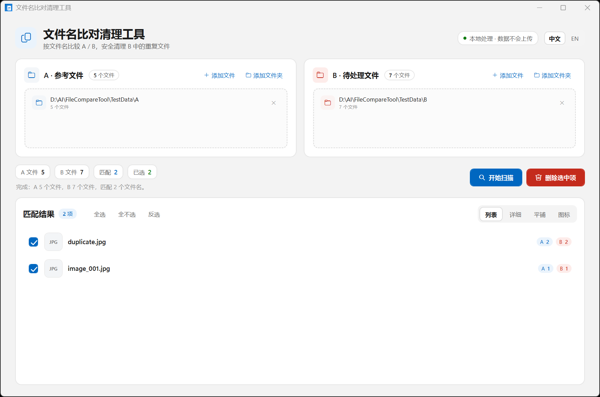
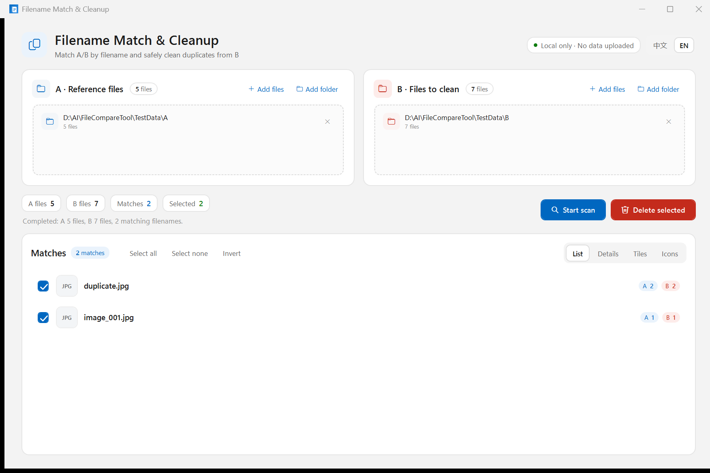

# File Compare Tool

[](https://github.com/Wang-Nainai/file-compare-tool/actions/workflows/build.yml)
[](LICENSE)

A modern Windows desktop app for comparing two file collections by filename and safely moving duplicate files from B to the Windows Recycle Bin. Everything runs locally; no filenames or file contents are uploaded.

| 简体中文 | English |
|:--:|:--:|
|  |  |

## Download

Download the latest self-contained build from [Releases](https://github.com/Wang-Nainai/file-compare-tool/releases/latest):

- `FileCompareTool-v1.0.0-win-x64.exe` — single executable for Windows 10/11 x64, no .NET installation required.
- SHA-256: `0CBA0207EC0797BD69787E552E1CBC11810483D93FF45A98C0989939230842A4`

The executable is not code-signed, so Windows SmartScreen may show a warning on first launch. Choose **More info → Run anyway** only if you trust this repository.

## Features

- **Filename matching** — compares A and B by filename only, case-insensitively.
- **Duplicate-aware** — keeps every path when several files share the same name.
- **Flexible input** — add files/folders or drag and drop; scans subdirectories recursively.
- **Large folder friendly** — asynchronous scan with live progress and cancellation.
- **Four result views** — list, details, tiles and icons.
- **Safe cleanup** — confirmation dialog, scan-snapshot validation and a final deletion guard before moving **B files only** to the Recycle Bin.
- **Overlap protection** — rejects identical, nested or otherwise overlapping A/B paths that could expose A files to deletion.
- **Bilingual UI** — switch between Simplified Chinese and English at runtime; the choice is remembered.
- **Native Windows look** — Fluent-inspired WPF interface, custom app icon and high-DPI support.
- **Local diagnostics** — unexpected errors are written to `%LOCALAPPDATA%\FileCompareTool\error.log`.

## Safety model

Deletion is intentionally conservative:

1. A/B paths are normalized and checked before scanning. Overlapping paths are rejected.
2. A scan snapshot records exactly which B files were seen.
3. The confirmation dialog shows the number of B files to be removed.
4. A deletion guard rejects anything outside the current B snapshot and anything inside any A path.
5. Files are moved to the Windows Recycle Bin so they can be restored later.

If the target drive has no Recycle Bin, Windows asks whether the files should be permanently deleted.

## Requirements

- Windows 10 or Windows 11 (x64)
- [.NET 8 SDK](https://dotnet.microsoft.com/download/dotnet/8.0) to build from source

The published self-contained build does not require a separate .NET installation.

## Build

```powershell
dotnet restore FileCompareTool.csproj
dotnet build FileCompareTool.csproj -c Release
```

## Run

```powershell
dotnet run --project FileCompareTool.csproj
```

## Test

The repository includes a dependency-free console test harness:

```powershell
dotnet run --project Tests/FileCompareTool.Tests/FileCompareTool.Tests.csproj -c Debug
```

The suite covers scanning, matching, path validation, deletion guards, localization and view-model integration. A real Recycle Bin test is opt-in:

```powershell
$env:FCT_RUN_RECYCLE_TEST = '1'
dotnet run --project Tests/FileCompareTool.Tests/FileCompareTool.Tests.csproj -c Debug
Remove-Item Env:FCT_RUN_RECYCLE_TEST
```

## Publish

Create a self-contained Windows x64 build:

```powershell
dotnet publish FileCompareTool.csproj -c Release -r win-x64 --self-contained true -o publish
```

Or build the single-file release executable:

```powershell
dotnet publish FileCompareTool.csproj -c Release -r win-x64 --self-contained true `
  -p:PublishSingleFile=true `
  -p:IncludeNativeLibrariesForSelfExtract=true `
  -p:EnableCompressionInSingleFile=true `
  -p:DebugType=None -p:DebugSymbols=false `
  -o publish-single
```

The output is in `publish/` or `publish-single/`. Do not commit these folders; generated build output is ignored by Git.

## Project structure

```text
FileCompareTool/
├─ Models/                 Observable models
├─ Services/               Scan, match, path validation, deletion guard, Recycle Bin, localization
├─ ViewModels/             Main window state and commands
├─ Views/                  WPF windows
├─ Resources/              Fluent styles and app icon
├─ Tests/                  Console test harness
├─ TestData/               Small sample folder tree
└─ docs/screenshots/       README screenshots
```

## Contributing

Issues and pull requests are welcome. Please read [CONTRIBUTING.md](CONTRIBUTING.md) before changing deletion, scanning or path-validation behavior.

## License

[MIT](LICENSE) © 2026 WangNainai

---

## 简体中文

一个本地运行的 Windows 文件名比对工具：按文件名比较 A / B，并将 B 中选中的重复文件安全移动到回收站。所有处理都在本机完成，不会上传文件名或文件内容。

### 下载

从 [Releases](https://github.com/Wang-Nainai/file-compare-tool/releases/latest) 下载最新版本：

- `FileCompareTool-v1.0.0-win-x64.exe`：Windows 10/11 x64 自包含单文件，无需安装 .NET
- SHA-256：`0CBA0207EC0797BD69787E552E1CBC11810483D93FF45A98C0989939230842A4`

程序未做代码签名，首次运行时 Windows SmartScreen 可能提示风险。确认信任本仓库后，可选择 **更多信息 → 仍要运行**。

### 功能

- 按文件名匹配，不区分大小写，保留重名文件的全部路径
- 支持拖放或选择文件/文件夹，递归扫描子目录
- 异步扫描，实时显示进度和文件数，可随时取消
- 列表、详细、平铺、图标四种结果视图
- 删除前二次确认；只删除本次扫描到的 B 文件，并移动到 Windows 回收站
- 自动阻止 A / B 路径重叠，删除时使用扫描快照和路径守卫双重校验
- 简体中文 / English 即时切换，并自动记住语言选择
- 现代化 Fluent 风格界面，支持高 DPI

### 使用

```powershell
dotnet run --project FileCompareTool.csproj
```

发布为自包含版本：

```powershell
dotnet publish FileCompareTool.csproj -c Release -r win-x64 --self-contained true -o publish
```

程序位于 `publish\FileCompareTool.exe`。

### 测试

```powershell
dotnet run --project Tests/FileCompareTool.Tests/FileCompareTool.Tests.csproj -c Debug
```

设置 `FCT_RUN_RECYCLE_TEST=1` 可执行真实回收站删除测试。

### 安全说明

- A 区域文件永远不会被删除。
- 只允许删除本次扫描快照中记录的 B 文件。
- A / B 路径相同、互相嵌套等情况会被拒绝。
- 删除通过 Windows 回收站完成；如果磁盘没有回收站，系统会提示是否永久删除。

### 许可证

[MIT](LICENSE) © 2026 WangNainai
